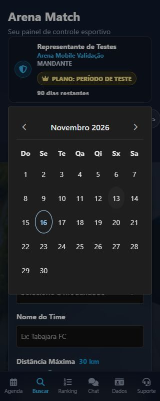

# ARENA-75 — base visual mobile first

Primeira entrega do épico ARENA-74, desenvolvida pelo Codex a partir da `main` no commit `8b8720a`. A branch é `ARENA-75`.

## Recursos compartilhados

Os caminhos de frontend abaixo são relativos a `src/main/resources/META-INF/resources/`.

| Recurso | Responsabilidade |
| --- | --- |
| `css/base.css` | Paleta, tipografia, espaçamentos, controles, foco, feedback, ações e contêiner de tabelas |
| `WEB-INF/template/recursos-visuais.xhtml` | PrimeFlex 3.3.1, Font Awesome 6.4.0 e carregamento da base |
| `css/styles.css` | Fundo do aplicativo, utilitários existentes e estados de liga |
| `css/layout.css` | Estilos extraídos do template privado, cuja evolução estrutural pertence à ARENA-76 |
| `css/institucional.css` | Estilos públicos que consomem a paleta compartilhada |

O template privado, login, ativação, recuperação e privacidade incluem `recursos-visuais.xhtml`. As páginas institucionais carregam `base.css` diretamente. As versões dos recursos visuais ficam centralizadas no fragmento.

Os estilos compartilhados usam a URL fornecida pelo ResourceHandler JSF e o parâmetro `rev=75`. Ao modificar um desses arquivos em outra entrega, atualizar sua revisão nas referências consumidoras para que o navegador obtenha o recurso publicado. O ResourceHandler mantém a resolução do contexto da aplicação e da biblioteca CSS.

## Identidade visual

A paleta segue a referência de `CLAUDE.md` da ARENA-70.

| Variáveis | Uso |
| --- | --- |
| `--am-bg`, `--am-navy`, `--am-panel`, `--am-glass` | Fundos e superfícies dark/glass |
| `--am-primary`, `--am-accent` | Ciano do aplicativo, `#0ea5e9` e `#38bdf8` |
| `--am-brand`, `--am-brand-hover` | Ciano público, `#19b5ee` e `#64d3fa` |
| `--am-text`, `--am-text-public`, `--am-muted`, `--am-muted-public` | Hierarquia de leitura |
| `--am-border`, `--am-border-public`, `--am-border-strong` | Bordas |
| `--am-focus` | Foco visível, `#65d7ff` |
| `--am-success`, `--am-warning`, `--am-danger` | Feedback semântico |
| `--am-font` | Segoe UI e fontes de sistema |
| `--am-space-*`, `--am-radius-*`, `--am-touch` | Espaçamentos, raios e área de toque de referência |

As variáveis públicas existentes `--bg`, `--panel`, `--text`, `--muted`, `--blue` e `--border` apontam para esses tokens. A legenda de jogos e convites continua sendo definida pelos estados de cada fluxo.

## Convenções para as próximas histórias

- Definir a composição base para 320 px e ampliar o layout por `min-width`, usando o espaço disponível.
- Usar PrimeFlex `col-12` como ponto de partida, com `md:` e `lg:` para ampliar a composição.
- Os breakpoints dos utilitários PrimeFlex são 576, 768, 992 e 1200 px. A estrutura privada extraída ainda usa o limite histórico de 980 px e será trabalhada na ARENA-76.
- A base de tabelas usa 480 px de largura interna mínima e amplia para 520 px a partir de 640 px. A rolagem pertence ao contêiner `.am-table-scroll`.
- `.am-actions` organiza ações em coluna e passa a linha com quebra a partir de 768 px. `.am-action-link` acrescenta uma área de toque aos links de ação.
- A exploração de ligas já utiliza o agrupamento compartilhado no cabeçalho, acomodando suas ações na faixa de transição para a sidebar.
- Acrescentar `styleClass="am-ui"` ao `h:body` das páginas PrimeFaces independentes. Esse escopo também alcança overlays que o componente adiciona ao body.
- Usar o fragmento de recursos comuns antes dos estilos específicos da página. A base possui seletores de componentes com escopo próprio para interagir com o tema Arya.
- A área de toque de referência dos campos, botões, seletores e acionador de senha é 44 CSS px. Os ajustes específicos das telas são tratados nas respectivas histórias.
- O calendário distribui sete colunas na largura disponível e usa 44 px de altura nos dias. A largura de cada dia acompanha a grade, permitindo selecionar datas a partir de 320 px.
- Preservar foco visível e mensagens após AJAX. Validar teclado, nomes extensos, estados desabilitados, erro e sucesso.
- Extrair os estilos de cada fluxo para seu recurso CSS durante a migração da respectiva história.
- Registrar consultas de altura, orientação e movimento reduzido quando o comportamento exigir essas condições.

## Validação

O ambiente de validação utiliza PostgreSQL 15 descartável. Os testes de integração e os dados fictícios da interface usam bancos separados dentro desse ambiente.

```powershell
.\mvnw.cmd clean verify
node --test src/test/js/analytics.test.cjs
```

Para habilitar os testes PostgreSQL da ARENA-67, configurar `ARENA67_TEST_DB_URL`, `ARENA67_TEST_DB_USER` e `ARENA67_TEST_DB_PASSWORD` apontando para o banco descartável de integração.

`RecursosVisuaisTest` verifica o fragmento, a unicidade dos recursos, o escopo de componentes, a declaração de viewport e a presença da base nas páginas públicas.

### Resultados em 16/11/2026

| Verificação | Resultado |
| --- | --- |
| Maven Wrapper, `clean verify` e verificações posteriores | 74 testes Java aprovados, incluindo PostgreSQL, com zero falhas, erros e testes ignorados |
| Analytics | 17 testes JavaScript aprovados |
| Matriz de apresentação e recursos | 171 verificações em 18 páginas, incluindo cadastro público e autenticado |
| Larguras verificadas | 320, 360, 390, 430, 768, 981, 992, 1024 e 1440 CSS px |
| Geometria final | Carregamento da base confirmado e controles conferidos dentro do viewport. Tabelas amplas usam seus contêineres de rolagem |
| Login | Campos, acionador de senha e recuperação com altura de 44 px. Acionador de senha com largura de 44 px |
| Feedback | Erros do login apresentados via AJAX, com borda de erro e foco de teclado de 3 px |
| Mensagens flutuantes | Largura de 273 px no viewport de 320 px com barra de rolagem, acomodando margens laterais de 16 px |
| Calendário | Painel de 288 px no viewport de 320 px, com seleção do dia 21 confirmada pela interface |
| Ligas | Criação e atualização via AJAX verificadas com equipe e liga fictícias. Cabeçalho conferido na transição de 981/992 px |

Os roteiros também incluíram seleção de modalidade, busca com resultado de nome extenso, abertura dos detalhes do adversário e carregamento do layout autenticado. A matriz confirma geometria e recursos das telas, complementando esses roteiros de interação.

A validação foi executada no navegador integrado com emulação de viewport. A homologação física no Android/WebView e a revisão completa dos fluxos administrativos compõem as histórias de migração e homologação do épico.

### Evidências

As capturas usam dados fictícios e largura de 320 CSS px.

| Antes | Base compartilhada aplicada |
| --- | --- |
|  |  |


