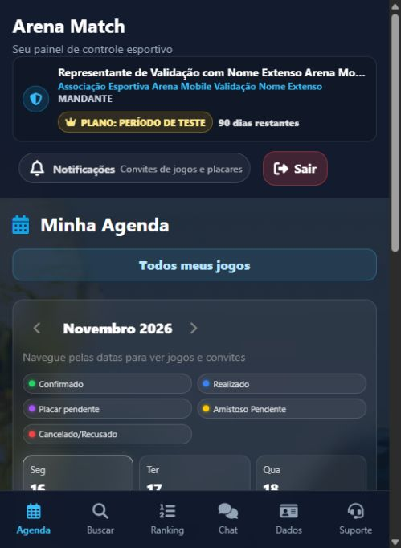
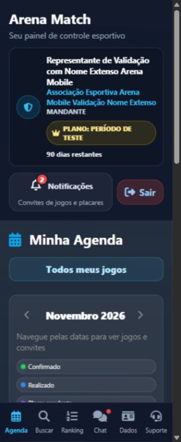
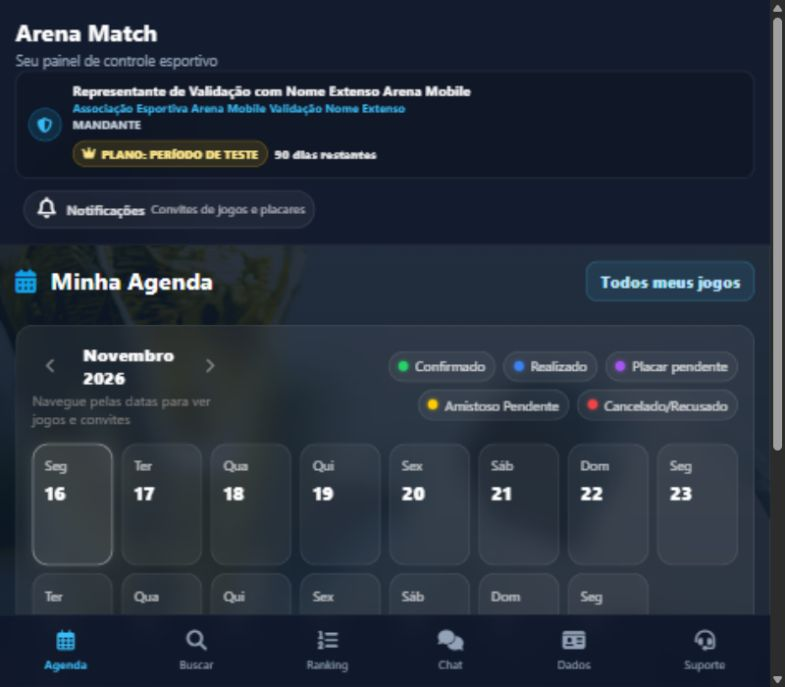
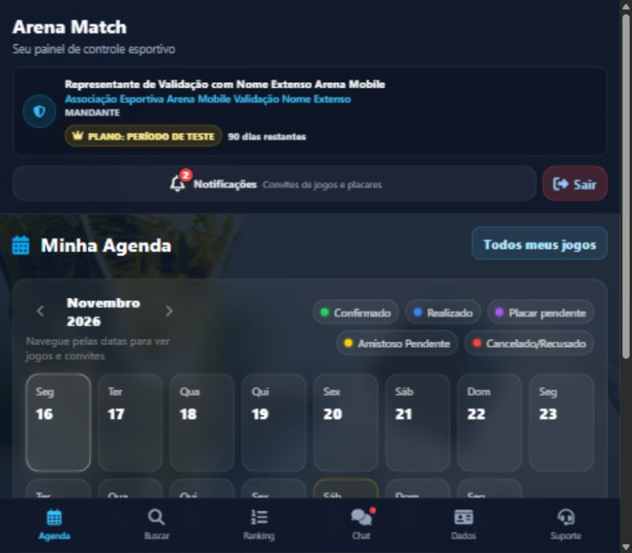
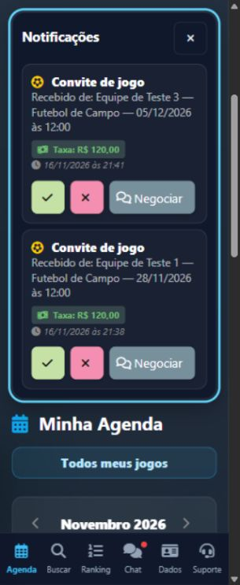
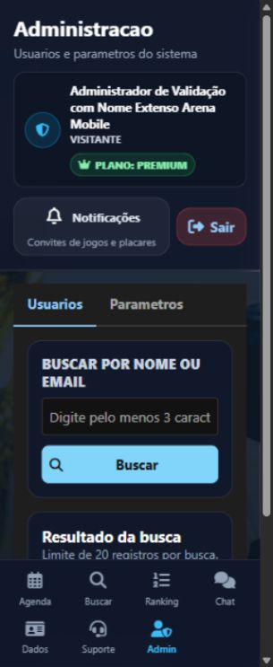
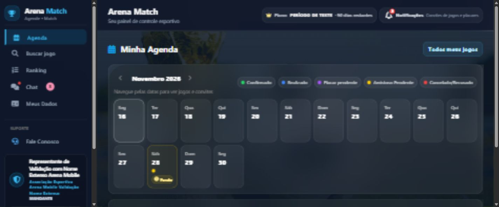
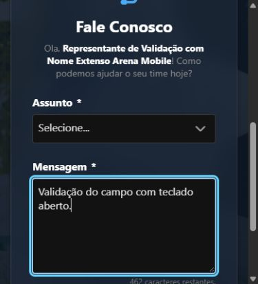

# ARENA-76 — Layout principal, navegação e notificações

## Base da entrega

Implementação do épico ARENA-74 na branch ARENA-76, a partir da main atualizada em `8b8720a`, com a dependência ARENA-75 incorporada pelo commit local `8d5b0c9`. A pasta de trabalho desta história é independente da implementação do Claude.

## Composição e navegação

- Uma coluna constitui o layout base. A sidebar aparece por `min-width: 62rem`, equivalente a 992 CSS px, alinhando a transição ao breakpoint `lg` do PrimeFlex.
- Cabeçalho mobile acompanha a rolagem da página. Identificação, time, plano, notificações e saída permitem quebra de linha e nomes extensos.
- Agenda, Buscar, Ranking, Chat, Dados e Suporte ficam disponíveis na barra inferior. O perfil administrativo acrescenta Admin.
- Em 320 px, o menu administrativo ocupa duas linhas de quatro colunas. A partir de 360 px, os sete destinos cabem em uma linha. As áreas de toque verificadas medem pelo menos 44 × 44 CSS px.
- `ResizeObserver` mede a altura efetiva do rodapé, incluindo quebras de linha e safe area. A área de conteúdo reserva essa altura, acrescida de uma margem de 1rem.
- A sidebar possui rolagem própria em janelas baixas. A altura utiliza `100dvh`, com fallback para `100vh`.
- Os estilos estruturais reutilizam a paleta compartilhada da ARENA-75. O breakpoint do fundo desktop também passa a 992 px.

## Teclado, ampliação e camadas

O viewport permite ampliação e inclui `viewport-fit=cover` e `interactive-widget=resizes-content`. O layout contempla os insets superior, inferior e laterais da área segura.

O módulo `js/layout.js` acompanha a redução de altura durante o preenchimento de campos de texto. Quando detecta o teclado, recolhe temporariamente a navegação fixa e reposiciona o campo que estiver fora da área visível. Mudança de largura e ampliação por `visualViewport.scale` recebem tratamento próprio. A navegação retorna ao encerrar a digitação ou recuperar a altura.

Os elementos focáveis possuem margens de rolagem considerando cabeçalho e rodapé. Notificações utilizam botão nativo, `aria-expanded`, título associado, fechamento acessível e Escape com retorno de foco ao acionador. As camadas da estrutura ficam abaixo dos overlays PrimeFaces.

## Atualizações das notificações

O componente `painelNotificacoesGlobais` contém o cabeçalho e as notificações. O conteúdo inserido pela página consumidora é seu irmão no template. Dessa forma, um refresh do sininho preserva os campos da página.

As ações de convite e cancelamento possuem formulários JSF próprios. As ações continuam atualizando as mensagens e a agenda, quando presente. Os campos de gols possuem labels associados.

O módulo restaura o estado aberto ou fechado após substituições AJAX. Eventos recebidos durante a edição de um placar ficam acumulados até a ação ou o fechamento do painel. Os indicadores de chat mantêm seus componentes e suas atualizações independentes. A URL SockJS considera o context path da aplicação.

## Validação em 16/11/2026

Os dados utilizados são fictícios, em PostgreSQL 15 descartável. A interface e os testes de integração utilizam bancos separados. O acesso administrativo foi conferido pelo fluxo normal de senha e código, com recebimento em servidor SMTP local de testes.

| Verificação | Resultado |
| --- | --- |
| Maven Wrapper, `clean verify` inicial e `verify` final | 75 testes Java aprovados, com zero falhas, erros e testes ignorados |
| `node --test src/test/js/*.test.cjs` | 25 testes aprovados, incluindo oito regressões do layout |
| Matriz de navegação | 60 cenários nas seis páginas principais, com a largura aplicada conferida em cada cenário |
| Larguras | 320, 360, 390, 430, 768, 844, 981, 992, 1024 e 1440 CSS px |
| Geometria | Zero overflow horizontal nos cenários, identificação e controles dentro da largura disponível |
| Administração | Sete destinos acessíveis, em duas linhas a 320 px e uma linha a 360 px. Navegação Agenda → Admin confirmada |
| Planos | Básico, período de teste, PRO e PREMIUM conferidos com contas fictícias |
| Desktop baixo | Sidebar de 600 px com conteúdo de 817 px e rolagem própria. Perfil administrativo também conferido em 1024 × 500 px |
| Paisagem | Seis páginas conferidas em 844 × 390 px. Último botão alcançado por Tab e totalmente acima da barra inferior |
| Teclado emulado | Redução de 390 × 844 para 390 × 430 px durante a digitação recolheu a barra e manteve o campo visível |
| Convites | Recebimento por WebSocket, abertura por Enter, fechamento por Escape e confirmação de jogo pela notificação |
| Preservação de edição | Texto do suporte e foco preservados durante chegada de convite e mensagem. Placar 3 × 2 preservado durante novo evento e salvo com sucesso |
| Chat | Contador passou de 3 para 4, com indicador mobile atualizado e formulário preservado |
| Validação e overlays | Mensagens de campos obrigatórios visíveis. Seletor PrimeFaces com z-index 1006 acima da navegação de z-index 100 |

`RecursosVisuaisTest` verifica também a separação entre notificações e conteúdo, os acionadores acessíveis e a ausência de botões AJAX fora de formulários ou formulários aninhados.

A validação visual utiliza o navegador integrado com emulação de viewport. O comportamento de ampliação foi verificado pela configuração do viewport e pelos testes do módulo. A homologação de pinch zoom, teclado, safe area e navegação em aparelho Android/WebView físico permanece pendente.

## Evidências

As comparações utilizam o mesmo nome fictício extenso. O estado dos convites pode diferir entre as duas bases locais.

| Antes da ARENA-76, 320 px | ARENA-76, 320 px |
| --- | --- |
|  |  |

| Antes da ARENA-76, 800 px | ARENA-76, 800 px |
| --- | --- |
|  |  |

