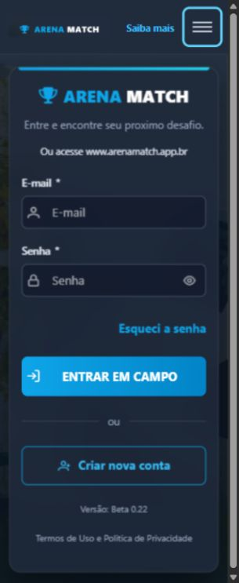
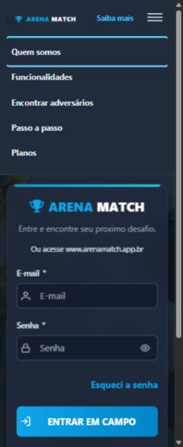
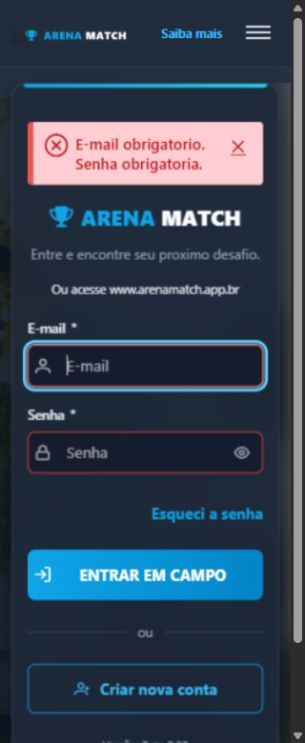
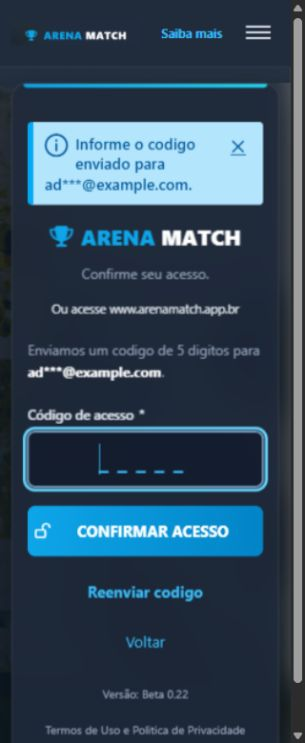
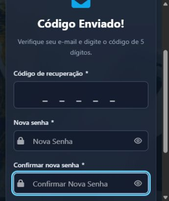
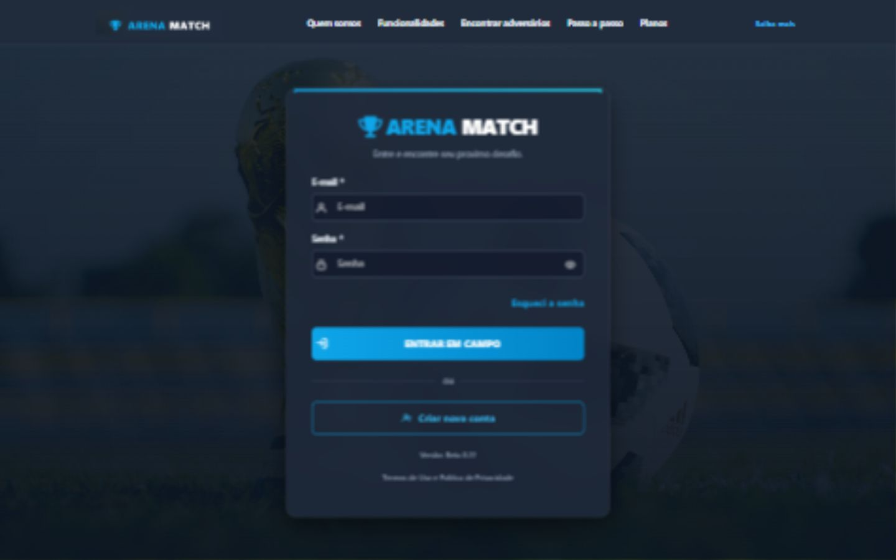

# ARENA-77 — Login, ativação e recuperação de senha

## Base da entrega

Branch ARENA-77 criada a partir da main atualizada em `8b8720a`, incorporando os commits locais da ARENA-75 (`8d5b0c9`) e da ARENA-76 (`7e00d0b`). A implementação utiliza a pasta de trabalho já existente desta sequência.

## Implementação

- `css/acesso.css` concentra os cartões, campos, códigos, ações, mensagens e estados de envio das três páginas. A composição inicial atende 320 px, com espaçamento ampliado por `min-width`.
- Os cartões começam alinhados ao topo em telas pequenas e janelas baixas. A centralização progressiva em desktop considera também a altura disponível. O layout utiliza `100dvh`, com fallback, e os insets da área segura.
- O login mantém o cabeçalho público com marca, Saiba mais e menu. O menu parte recolhido e apresenta os destinos na própria estrutura da página ao abrir. A navegação expandida de desktop começa em 992 px, alinhada à estrutura autenticada.
- A abertura do menu leva o foco ao primeiro destino. Escape devolve o foco ao botão. O menu também fecha ao sair pelo teclado, clicar fora, escolher um destino ou mudar de composição.
- E-mail, senha e códigos possuem labels associados. E-mail recebe teclado e preenchimento automático apropriados. Os códigos usam cinco dígitos, `inputmode="numeric"` e `autocomplete="one-time-code"`.
- Os acionadores de visibilidade de senha e fechamento de mensagens possuem área de toque de 44 px. As ações principais usam botões de formulário e admitem envio por Enter.
- As mensagens aparecem no cartão, com quebra de texto e foco no campo inválido ou no aviso do backend. A apresentação dos detalhes evita repetir mensagens de validação idênticas.
- O envio AJAX sinaliza `aria-busy`, apresenta Processando e mantém o indicador de carregamento do PrimeFaces. O módulo `js/acesso.js` acompanha a redução do viewport para revelar o campo em edição.
- O reenvio de ativação processa o e-mail. O campo de código pode estar vazio. Após um reenvio bem-sucedido, os códigos anteriores de ativação e de acesso administrativo são limpos da tela.

## Fluxos verificados

| Fluxo | Resultado |
| --- | --- |
| Login comum | Obrigatoriedade, senha incorreta, visibilidade da senha, envio por Enter e redirecionamento para a agenda |
| Acesso público | Menu por toque e teclado, retorno do foco por Escape, abertura do cadastro gratuito e do guia |
| Ativação | Login com ativação pendente, e-mail preenchido no destino, códigos inválido e expirado, reenvio com código vazio e ativação com retorno ao login |
| Administração | Código inválido, código expirado, retorno ao login, intervalo de reenvio, reenvio bem-sucedido e acesso ao painel administrativo por Enter |
| Recuperação pela interface | E-mail obrigatório, e-mail inexistente, envio, segunda etapa, campos de código e senhas, controles de visibilidade e retorno para alterar o e-mail |
| Recuperação pela API e testes do bean | Código inválido e expirado, confirmação divergente, gravação bem-sucedida, retorno ao login e autenticação após a redefinição |
| Teclado emulado | Campos de senha, confirmação e código permaneceram dentro da altura útil em 320/360 × 430 px. As ações finais foram alcançadas por Tab |

## Validação em 16/11/2026

Os cenários utilizam contas fictícias em PostgreSQL 15 descartável, com bancos separados para a interface e os testes de integração. O envio de códigos utiliza um servidor SMTP local. Uma demora de três segundos foi simulada nesse servidor para conferir o estado de envio.

| Verificação | Resultado |
| --- | --- |
| Maven Wrapper, `verify` | 82 testes Java aprovados, com zero falhas, erros ou testes ignorados |
| `node --test src/test/js/*.test.cjs` | 32 testes aprovados |
| Matriz principal | 35 combinações nas três páginas iniciais e nas etapas de código administrativo e redefinição |
| Larguras | 320, 360, 390, 768, 844, 992 e 1440 CSS px |
| Geometria | Zero overflow horizontal e controles visíveis com área de toque mínima de 44 × 44 px nas combinações verificadas |
| Altura reduzida | Conferidas paisagem em 844 × 390 px e redução da área útil durante foco de campos em 320/360 px |
| API local de recuperação | HTTP 400 para código inválido e expirado, HTTP 200 para redefinição válida e login posterior bem-sucedido |
| Navegador | Fluxos de navegação e mensagens verificados, com zero erros de console na revisão final |

`RecursosVisuaisTest` confere os recursos compartilhados, estrutura pública, labels, códigos numéricos e escopo de processamento do reenvio. Os testes JavaScript cobrem menu, foco, envio e viewport. Os testes dos beans cobrem o fluxo de recuperação e a limpeza dos códigos após reenvio.

A homologação física em Android/WebView permanece pendente, incluindo teclado real, pinch zoom, preenchimento automático de códigos e safe area. As capturas e os cenários de viewport foram executados no navegador integrado.

## Evidências

As imagens utilizam dados fictícios.

| Antes, 320 px | ARENA-77, 320 px |
| --- | --- |
|  |  |
|  |  |
|  |  |

