# ARENA-78 — Cadastro e edição do time

## Base da entrega

Branch ARENA-78 criada a partir da main atualizada em `8b8720a`, incorporando as dependências locais ARENA-75 (`8d5b0c9`), ARENA-76 (`7e00d0b`) e ARENA-77 (`25bc2f3`). Esta é a quarta história do épico ARENA-74.

Em 17/11/2026, o usuário dispensou a adaptação de Ligas. A ARENA-83 foi retirada da sequência do épico, a ARENA-81 passa a abranger o chat de partidas e a ARENA-86 adota o escopo atualizado. A sequência vigente tem 11 histórias.

## Implementação

- `css/cadastro.css` concentra a apresentação, com escopo `.am-cadastro` e `.am-cadastro-dialog`. A base usa uma coluna e amplia os campos para duas colunas a partir de 768 px.
- O template principal recebe um ponto de inclusão para estilos da página. O cadastro usa os recursos compartilhados de cores, tipografia, foco e áreas de toque.
- O cabeçalho identifica Responsável, Time e Agenda com lista ordenada e `aria-current`. Avançar ou voltar direciona o foco ao título da etapa. A validação direciona o foco ao campo inválido ou às mensagens dentro do cartão.
- CPF, celular, e-mail, senhas, CEP, endereço, mando, campo e taxa possuem rótulos associados e dimensionamento fluido. E-mail, CPF, celular e CEP usam os modos de entrada apropriados.
- O envio sinaliza `aria-busy` e apresenta o estado Processando. O módulo compartilhado acompanha a redução do viewport para revelar o campo em edição. Consultas parciais de CEP direcionam o foco à própria mensagem, evitando retornar a um campo inválido de outra ação.
- A disponibilidade usa seletores de modalidade, categoria, dia e horários. As validações de inclusão são executadas pelo fluxo existente. A finalização processa os horários adicionados.
- A tabela de horários aparece como cartões no celular e como tabela a partir de 768 px. A exclusão mostra ícone e texto, possui área de toque mínima de 44 px e processa apenas o próprio botão, cobrindo a regressão ARENA-32.
- Os diálogos usam largura limitada pelo viewport, conteúdo rolável e ações empilhadas na base. O posicionamento considera a mudança de orientação. A leitura dos termos recebe foco e permite navegação por teclado até o fim do texto.
- O upload recebe seleção e prévia dimensionadas para o celular. O teste real identificou `NoClassDefFoundError` de `org.reactivestreams.Publisher` no cliente multipart. A correção usa `LinkedMultiValueMap`, `HttpEntity` e `ByteArrayResource` com o `RestClient`, incluindo fechamento do fluxo do arquivo.
- A finalização com ativação de conta encaminha o e-mail informado pelo Flash do JSF para a tela de ativação, reutilizando o contrato existente desse fluxo.

## Validação em 17/11/2026

Os testes utilizam contas fictícias em PostgreSQL 15 local e descartável. Há bancos separados para a interface e os testes de integração. Os códigos de ativação são enviados a um SMTP local. A consulta de CEP encontrou o endereço de teste pela integração existente. A chave de geocodificação usada na prévia é fictícia.

| Verificação | Resultado |
| --- | --- |
| Maven Wrapper, `verify` | 87 testes Java aprovados, zero falhas, erros ou testes ignorados |
| `node --test src/test/js/*.test.cjs` | 40 testes aprovados |
| Matriz do assistente | 24 combinações, com as três etapas em cada dimensão |
| Dimensões verificadas | 320 × 780, 360 × 780, 390 × 844, 768 × 1024, 992 × 900, 1440 × 1000, 844 × 390 e 320 × 430 CSS px |
| Geometria | Zero overflow horizontal da página, controles dimensionados em pelo menos 44 × 44 px nas combinações medidas |
| Cadastro pela interface | Responsável, validação de CPF, endereço pelo CEP, mandante, campo, taxa, duas modalidades, horários, leitura dos termos, finalização e ativação |
| Edição pela interface | Upload com prévia e sucesso, alteração de endereço complementar, inclusão e exclusão de horários, salvamento e retorno à agenda |
| Persistência | Endereço complementar, taxa e escudo gravados. Campo e Futsal preservados ao excluir o horário de Campo e acrescentar Fut 7 |
| CEP | Obrigatoriedade, CEP inexistente e preenchimento de endereço encontrado com feedback dentro do assistente |
| Disponibilidade | Modalidade e categoria obrigatórias, duração de duas horas para mandante e exclusão com campos de inclusão vazios |
| Altura reduzida | Ação de inclusão e retorno alcançáveis por Tab em 320 × 430 e 844 × 390 px |
| Diálogo de desativação | Abertura, leitura, cancelamento e mudança de orientação. Ações dentro do viewport e sem overflow horizontal do diálogo |

`RecursosVisuaisTest` confere os componentes do assistente, os recursos da página e o processamento isolado da exclusão. Os testes JavaScript cobrem foco, mensagens de GPS, resposta tardia de localização e leitura dos termos. Os testes Java adicionais cobrem o encaminhamento para ativação/login e o formato multipart do upload.

## Pendências de homologação

A homologação física em Android/WebView permanece pendente, incluindo teclado real, safe area e seleção de arquivos no aparelho. A redução de altura foi emulada no navegador.

A conferência de zoom no Chrome foi interrompida pela ferramenta de automação, que informou não conseguir confirmar a URL da janela do Windows. A verificação de ampliação real de texto/zoom permanece pendente. A história segue Em andamento para homologação.

## Evidências

As capturas utilizam dados fictícios. As imagens de antes foram registradas na base da história anterior. As evidências de validação de CEP, termos e cadastro concluído foram registradas durante a execução do fluxo. As capturas de depois do assistente mostram a revisão final dos campos e cartões.

| Antes, 320 px | ARENA-78, 320 px |
| --- | --- |
| 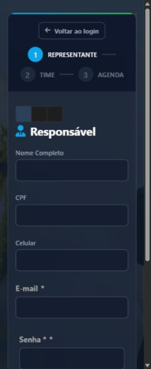 | 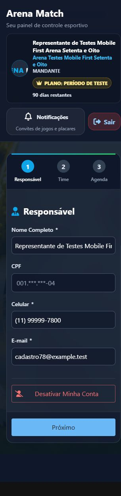 |
| 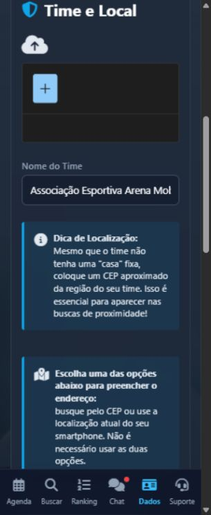 | 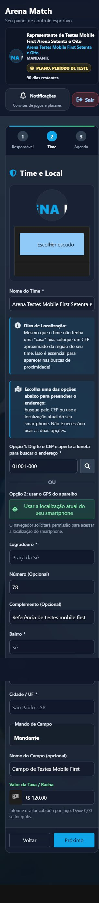 |
| 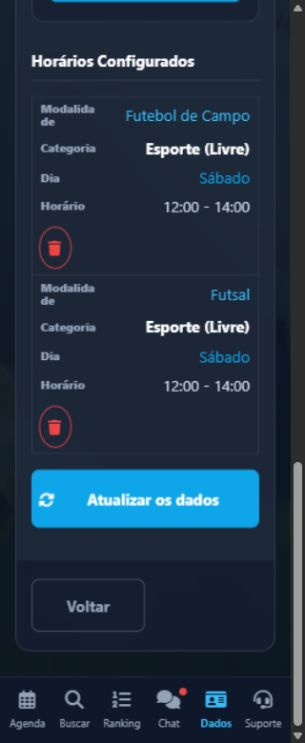 | 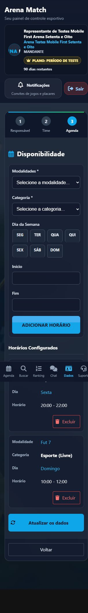 |

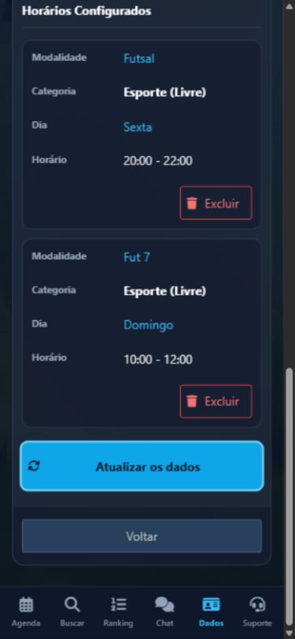

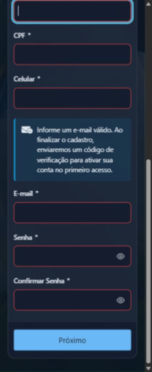

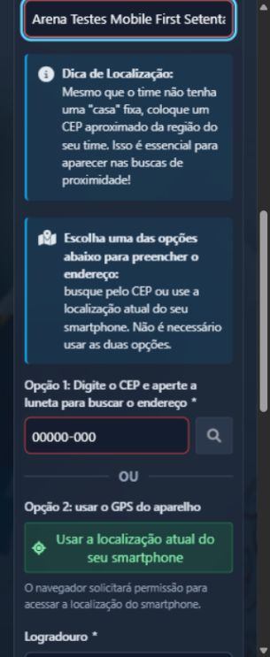

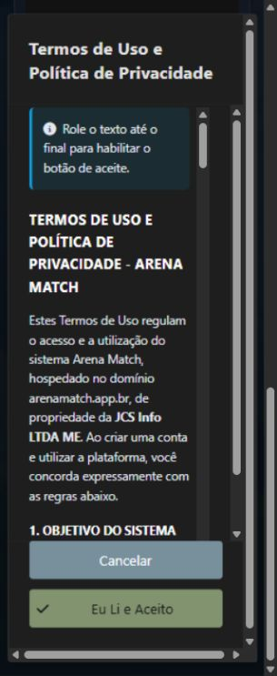

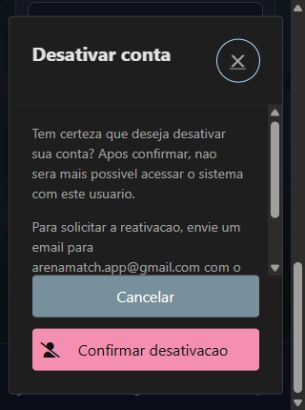

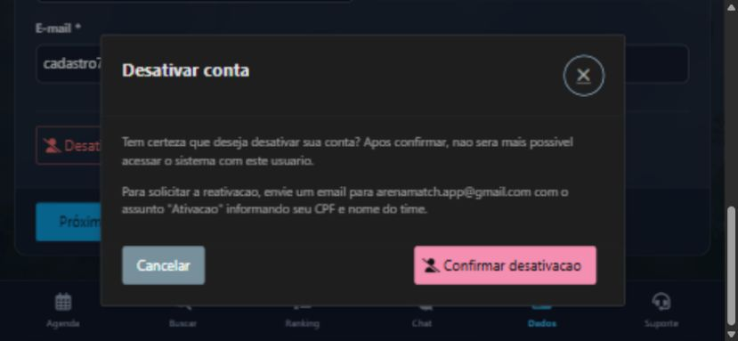

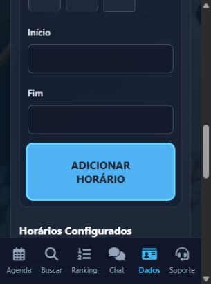

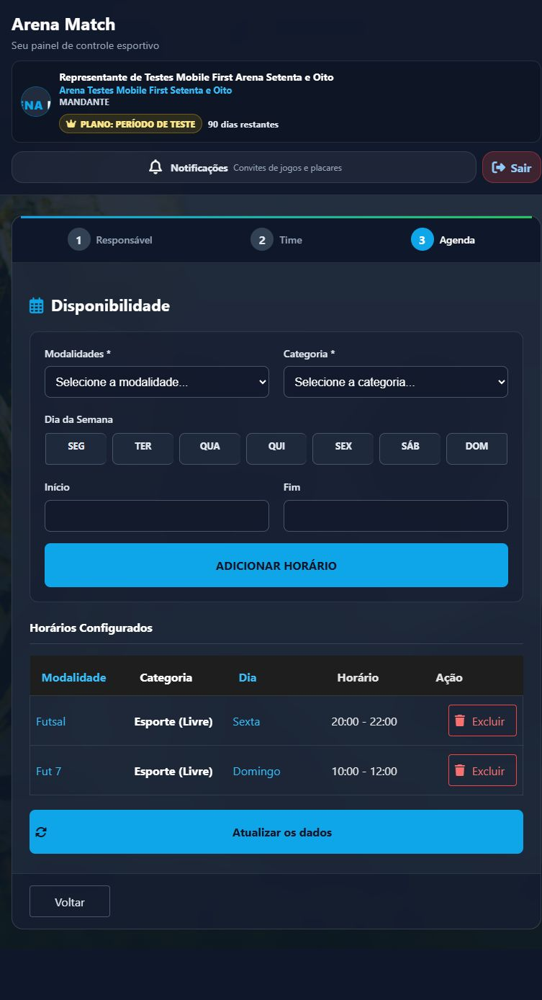

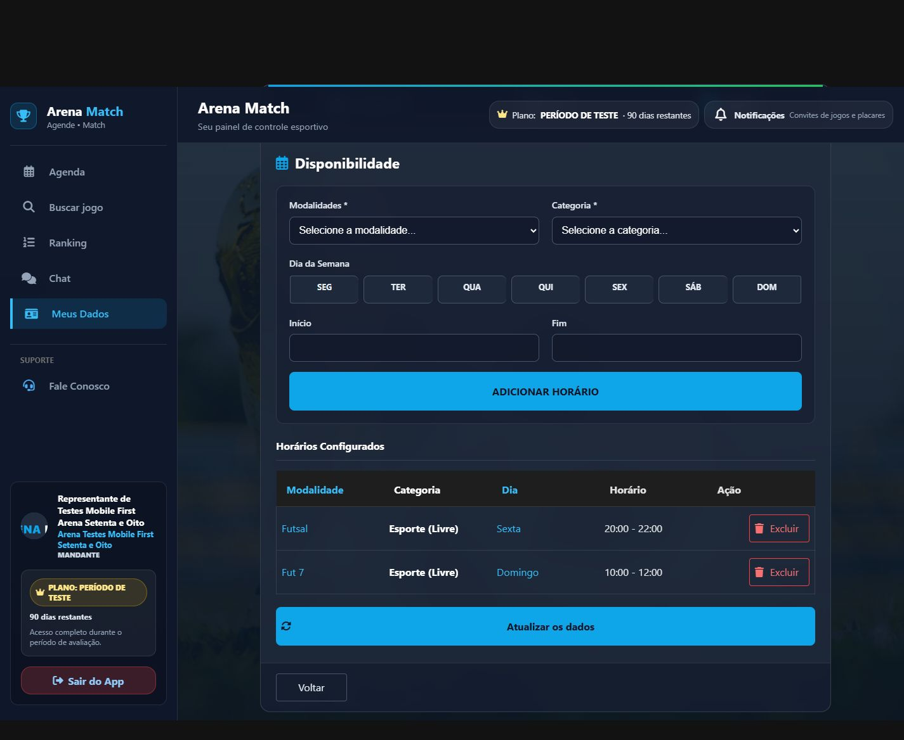
