# ARENA-79 — Busca de adversários e desafios

## Base da entrega

Branch ARENA-79 criada a partir da main atualizada em `8b8720a`, com as dependências locais ARENA-75, ARENA-76, ARENA-77 e ARENA-78 incorporadas. A base imediata é o commit `bb1d754`. Esta entrega corresponde à quinta história da sequência vigente de 11 histórias do épico ARENA-74.

## Implementação

- `css/busca.css` concentra a apresentação com escopo `.am-busca`. Os filtros começam em uma coluna, passam a duas em 768 px e a três em 1200 px. Os cartões usam grid fluido conforme a largura disponível do conteúdo, considerando o menu lateral.
- Os nomes completos dos adversários recebem quebra de linha. Modalidade, categoria, horário, mando e taxa ficam organizados em campos de comparação. Os valores de modalidade têm destaque verde, com rótulos claros.
- Data, modalidade, categoria, nome e distância recebem rótulos associados. A distância usa um controle HTML de faixa integrado ao JSF, com ajuste por toque e teclado, legenda atualizada durante a interação e bloqueio pelo plano Básico.
- O calendário permite digitação numérica e abertura por botão identificado. O modo automático touch do PrimeFaces 14 foi desativado nesta página após a revisão mobile. O popup utiliza o destino `@(body)` e o posicionamento do componente, com os estilos compartilhados de calendário.
- A busca apresenta mensagens no formulário, estado Processando e foco nos resultados ou na mensagem de validação. O Enter no campo de nome aciona a pesquisa.
- A paginação fica ao final dos resultados, com uma página numerada visível e controles dimensionados para toque. O estado inicial e a busca vazia usam mensagens distintas. A troca de modalidade limpa os resultados e a confirmação. Uma nova pesquisa reinicia a paginação.
- A revisão do desafio apresenta adversário, modalidade, categoria, data, papel do próprio time, taxa, horário e mensagem opcional. As ações ficam empilhadas para leitura e toque no celular.
- O contexto da pesquisa é copiado para a revisão e a atualização dos cartões. Editar filtros antes de enviar um convite mantém o envio associado ao resultado que foi revisado.
- Convites enviados e recebidos apresentam estado e acesso ao chat. O convite recebido oferece Ver convite, que abre a agenda na data correspondente para resposta.

## Correções verificadas no fluxo

### Taxa do mandante

O resultado consultava a taxa do adversário mesmo quando o próprio time era o mandante. A busca passa a apresentar a taxa do mandante da partida, acompanhando a regra usada para o horário. Há testes para mandante pago, mandante gratuito e visitante.

### Cancelamento de convite

O cartão passa a cancelar pelo identificador da partida pendente. O resultado é atualizado após a ação. A operação por adversário abrangia um contexto mais amplo e dependia da posição do time entre mandante e visitante.

O teste pela API também reproduziu HTTP 400 ao cancelar um convite que possuía mensagem no chat. A exclusão agora remove as mensagens vinculadas antes da partida, dentro da transação.

Aceitar e cancelar consultam o convite com bloqueio de atualização. O aceite verifica o estado PENDENTE. No teste simultâneo, o aceite retornou HTTP 200 e o cancelamento retornou HTTP 400. A partida permaneceu AGENDADO, com sua mensagem. Repetir o aceite de outro jogo já confirmado retornou HTTP 400.

Uma falha de atualização dos resultados após o envio apresenta orientação para refazer a busca, informando que a ação no convite já foi concluída.

## Destino de busca.xhtml

O levantamento de referências encontrou a navegação ativa em `busca-time.xhtml`. A página antiga `busca.xhtml` utilizava filtros e um botão de desafio que já divergiam do fluxo atual.

O endereço antigo passa a redirecionar pelo JSF para `busca-time.xhtml`, encaminhando os parâmetros de data e modalidade. O teste pelo navegador confirmou o destino com `data=2026-11-21&modalidade=FUTEBOL_CAMPO`.

## Validação em 17/11/2026

Os cenários utilizam equipes e contas fictícias no PostgreSQL 15 local. O banco da interface e o banco dos testes de integração são separados. Foram acrescentadas 14 equipes de teste para exercer paginação e nomes extensos.

| Verificação | Resultado |
| --- | --- |
| Maven Wrapper, verify | 103 testes aprovados, zero falhas, erros ou testes ignorados |
| Testes JavaScript | 45 testes aprovados |
| Matriz de resultados e revisão | 18 combinações, com zero overflow horizontal da página |
| Dimensões | 320 × 780, 360 × 780, 390 × 844, 768 × 1024, 992 × 900, 1024 × 900, 1440 × 1000, 844 × 390 e 320 × 430 CSS px |
| Controles medidos | Campos, seletores, botões e links da paginação em pelo menos 44 × 44 px nas combinações verificadas |
| Calendário | Os dias distribuem sete colunas na largura disponível, com altura de 44 px conforme a base compartilhada |
| Busca | Modalidade e data obrigatórias, busca por Enter, nome sem correspondência, retorno vazio e paginação em duas páginas |
| Modalidade | Campo com 16 resultados e Futsal com 9 no conjunto de teste. A troca limpa os cartões e reinicia a paginação |
| Planos | Trial com histórico disponível. Básico com raio fixado em 10 km, histórico bloqueado e mensagem de intervalo de agendamento ao tentar enviar novo desafio |
| Detalhes | Navegação com identificador, data, categoria e modalidade do resultado |
| Envio | Convite criado pela interface, mensagem encaminhada ao chat e data da revisão preservada ao editar o campo de pesquisa antes do envio |
| Recebimento | Cartão com convite recebido, acesso à agenda na data correta e aceite pela interface, com jogo confirmado |
| Cancelamento pela API | HTTP 204 para convite com mensagem. Convite de outra data mantido e mensagens do convite cancelado removidas |
| Altura reduzida | A ação de envio ficou alcançável por Tab em paisagem e com redução de altura durante a edição da mensagem |

Os testes novos cobrem contexto da pesquisa, obrigatoriedade, limite Básico, reinício de paginação, revisão após erro, atualização após envio, cancelamento por partida, taxa do mandante e validação do estado ao aceitar/excluir. Os testes JavaScript cobrem o foco, o botão do calendário e a legenda de distância.

## Homologação pendente

A conferência física em Android/WebView permanece pendente, incluindo teclado real, áreas seguras e comportamento dos seletores no aparelho. A altura reduzida foi emulada no navegador integrado. A ampliação real de texto/zoom integra a homologação final do épico. A história segue Em andamento para homologação.

## Evidências

As capturas usam dados fictícios. As imagens de antes correspondem à base da ARENA-78.

| Antes | ARENA-79 |
| --- | --- |
| 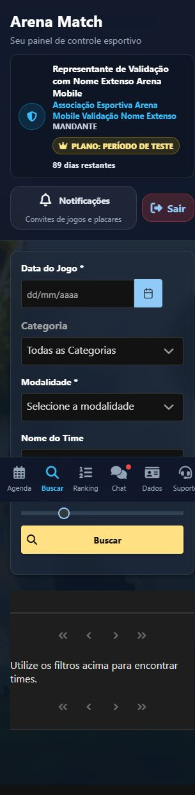 | 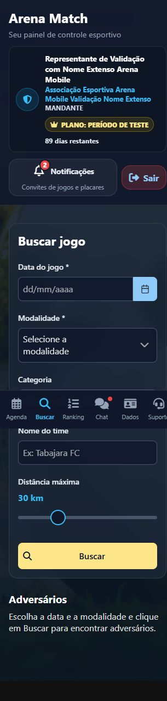 |
| 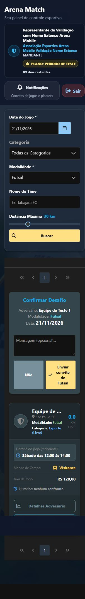 | 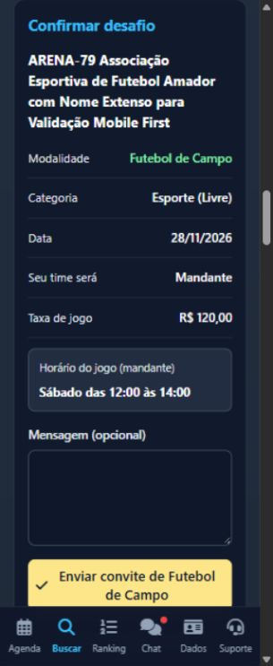 |

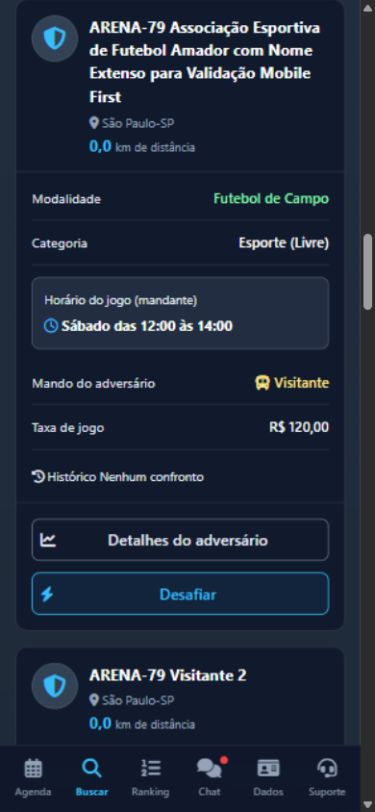

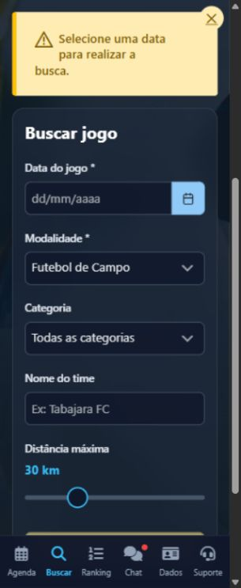

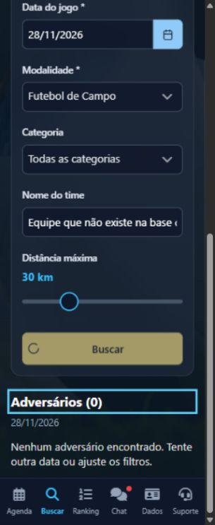

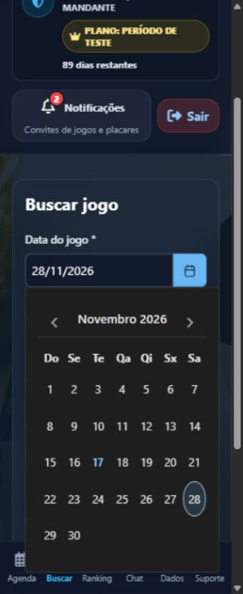

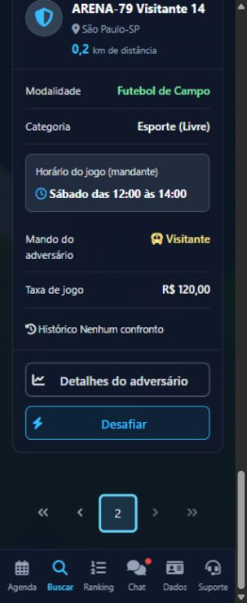

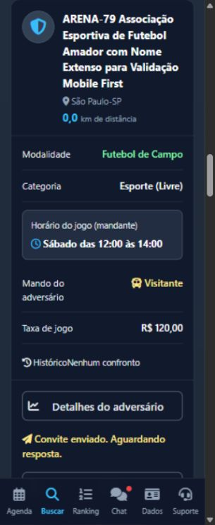

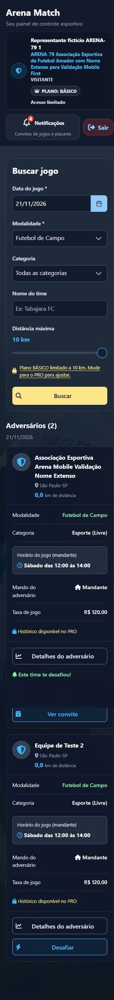

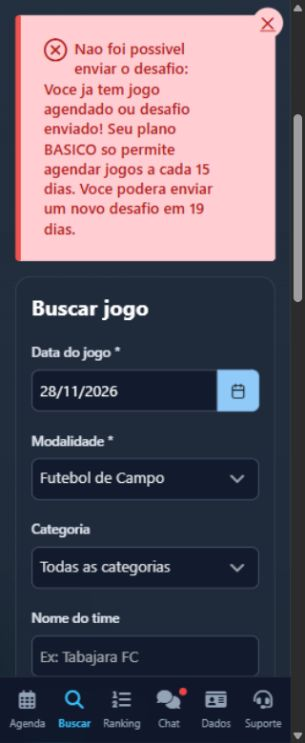

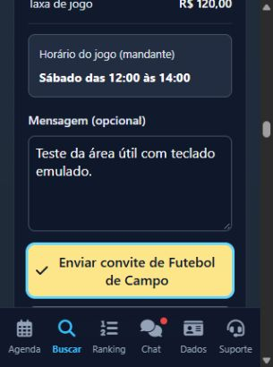

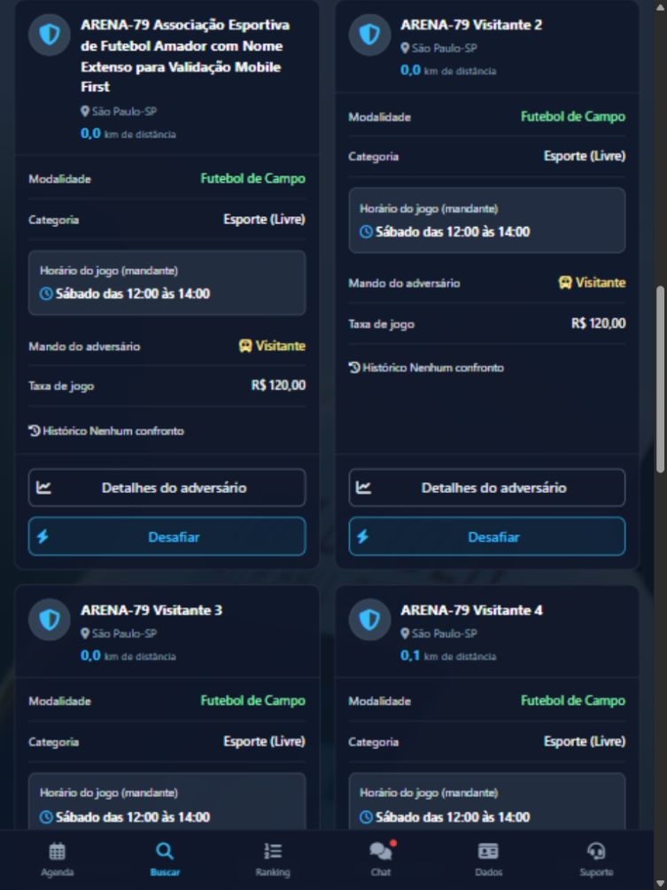

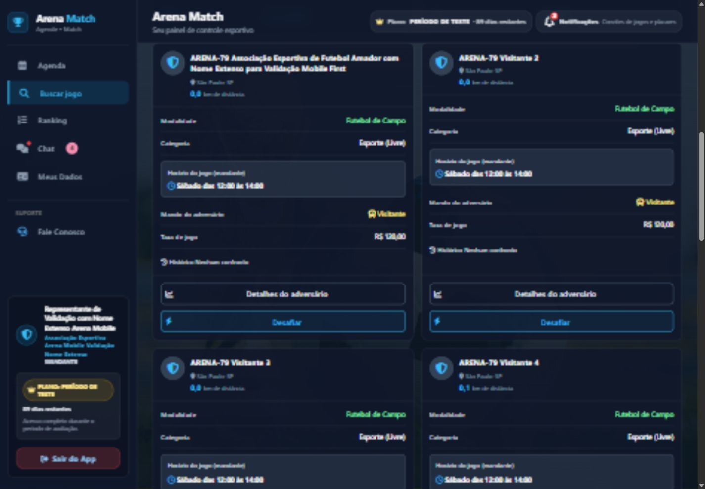

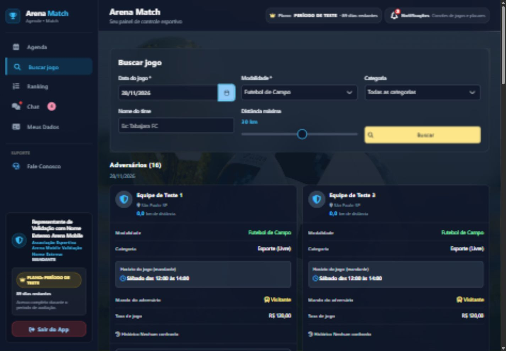
